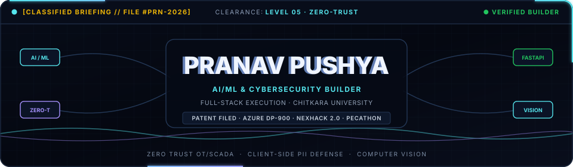
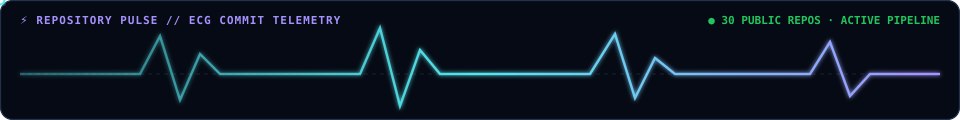

<div align="center">



[](https://www.linkedin.com/in/pranav-pushya/)
[](mailto:pushyapranav24@gmail.com)
[](https://github.com/pranav-pushya?tab=repositories)
[](https://www.linkedin.com/in/pranav-pushya/)

</div>


## ⚡ Developer Identity



> Full-stack development is my **execution layer** (FastAPI, React, Firebase, Neon, Render), while **AI/ML** (LLMs, RAG, MediaPipe, Computer Vision) and **Cybersecurity** (Zero Trust, ethical hacking sandboxes, client-side PII protection) are my core differentiators.


## 🚀 Engineering Registry &amp; Featured Systems

| System | Domain &amp; Architecture | Core Stack | Links |
| :--- | :--- | :--- | :--- |
| **01 / TRUSTGRID** | Zero Trust OT/SCADA water pipeline simulation with mTLS segmentation &amp; anomaly telemetry *(NexHack 2.0 @ IITM)* | `FastAPI` · `Python` · `React` · `Zero Trust` | [Repo ↗](https://github.com/armaankhan2905/CTRL-ALT-TRUST) |
| **02 / PrivacyLens (PS-004)** | Client-side PII redaction Chrome extension &amp; web app using offscreen canvas blackout &amp; Verhoeff/Luhn validation *(PECathon)* | `JavaScript` · `Canvas API` · `Local RAG` | [Repo ↗](https://github.com/PECathon-2026/05-HoneyPoters) |
| **03 / PwnBox** | Interactive browser-based ethical hacking &amp; social engineering defense sandbox built for safe hands-on practice | `Cybersecurity` · `JavaScript` · `Labs` | [Repo ↗](https://github.com/pranav-pushya/Pwnbox) · [Live ↗](https://pwnbo-x.web.app) |
| **04 / Scaffold** | Unified developer identity &amp; growth OS with Kanban workflow, live portfolio showcase, ATS resume export &amp; Groq AI | `React` · `Firebase` · `Groq API` | [Repo ↗](https://github.com/pranav-pushya/Scaffold) · [Live ↗](https://scaffold-app-90278.web.app/) |
| **05 / SwachhSort AI** | Two-stage conveyor waste sorting vision pipeline (YOLO11m + MobileNetV2 + Depth Anything V2 pseudo-LiDAR) *(Patent Filed)* | `YOLO11m` · `MobileNetV2` · `Depth V2` | *Patent Filed* |
| **06 / CogniFlow &amp; FaceVerse-AR** | Passive fatigue-aware UI adapter *(Hack Helix @ TIET)* &amp; private on-device MediaPipe/Three.js AR playground | `MediaPipe` · `Three.js` · `WebGL` | [FaceVerse ↗](https://github.com/pranav-pushya/FaceVerse-AR) · [Live ↗](https://pranav-pushya.github.io/FaceVerse-AR/) |

<details>
<summary><strong>🔍 Expand System Architecture Flows (TRUSTGRID &amp; PrivacyLens)</strong></summary>

**TRUSTGRID (Zero Trust OT/SCADA Pipeline):**
```text
[Sensors & Actuators] ──(mTLS)──> [Zero Trust Gateway] ──(JWT/RBAC)──> [FastAPI Simulation] ──(WebSocket)──> [React Telemetry UI]
```
* Micro-perimeters around water pressure pump controls prevent lateral movement; telemetry monitors detect unauthorized valve states.

**PrivacyLens (Zero-Leakage Client-Side Pipeline):**
```text
[DOM Text/Image Input] ──> [Offscreen Canvas Blackout Masking] ──> [Verhoeff / Luhn Checksum Engine] ──> [Local RAG Masking]
```
* 100% on-device browser redaction with Verhoeff/Luhn validation eliminates false positives and guarantees zero server leakage.

</details>


## 🛠 Tech Stack &amp; Skill Radar

### 💻 Programming Languages


### 🤖 AI, Machine Learning &amp; Computer Vision


### 🎨 Frontend Development


### ⚙️ Backend &amp; Cloud


### 🛡️ Cybersecurity, Systems &amp; DevOps


<br/>




## 📊 Real-Time GitHub Telemetry &amp; Contribution Matrix

<div align="center">




[](https://github.com/pranav-pushya)
[](https://github.com/pranav-pushya)

[](https://github.com/pranav-pushya)

[](https://github.com/pranav-pushya)

</div>


## 🏆 Verified Credentials, KPIs &amp; Milestone Log




<div align="center">

### Let's build resilient AI &amp; Security systems together.

Open for **internship opportunities**, **hackathon teams**, and **AI &amp; Zero-Trust security collaborations**.

[](mailto:pushyapranav24@gmail.com)
[](https://www.linkedin.com/in/pranav-pushya/)
[](https://github.com/pranav-pushya?tab=repositories)


<br/><br/>


</div>
