[-0078D4?style=flat-square&logo=microsoftazure&logoColor=white)](https://www.linkedin.com/in/pranav-pushya/)

## ⚡ Primary Identity & Context

I am an **AI/ML & Cybersecurity Builder** (Applied AI & Security Developer) and 2nd-year CSE (AI/ML) undergraduate at **Chitkara University** (Expected 2029 · CGPA 8.4).

Full-stack development is my **execution layer** (FastAPI, React, Firebase, Supabase), while **AI/ML** (LLMs, RAG, MediaPipe, Computer Vision) and **Cybersecurity** (Zero Trust, ethical hacking sandboxes, client-side PII protection) are my core differentiators.

> *Building systems that solve hard, practical problems—engineered to be explained and audited, not just shipped.*

## 🚀 Featured Systems & Builds

<table>
<tr>
<td width="50%" valign="top">

### 01 / TRUSTGRID

**Zero Trust OT/SCADA Water Pipeline Simulation**

A software simulation of an industrial OT/SCADA water pipeline secured using Zero Trust architecture principles. Built and presented at **NexHack 2.0 (IITM Janakpuri)**.

* **Key Focus:** OT/SCADA security, Zero Trust segmentation, real-time telemetry anomaly monitoring.
* **Contribution:** Core architecture and simulation/backend logic.
* **Tech:** `FastAPI` · `Python` · `React` · `Zero Trust`

[Explore Repository ↗](https://github.com/armaankhan2905/CTRL-ALT-TRUST)

</td>
<td width="50%" valign="top">

### 02 / PrivacyLens (PS-004)

**Client-Side Privacy & PII Redaction Engine**

A privacy-first Chrome Extension and web app that scans and redacts sensitive PII locally before data ever leaves the user's browser. Built for **PECathon 2026**.

* **Key Focus:** Zero server-side leakage, offscreen canvas blackout masking, Verhoeff/Luhn checksum validation pipelines, and local RAG scanning.
* **Contribution:** End-to-end browser extension engineering, checksum validation, and local masking engine.
* **Tech:** `JavaScript` · `Canvas API` · `RAG Scanning` · `Chrome Extensions`

[Explore Repository ↗](https://github.com/PECathon-2026/05-HoneyPoters)

</td>
</tr>
<tr>
<td width="50%" valign="top">

### 03 / PwnBox

**Interactive Cybersecurity Learning Sandbox**

A browser-based, hands-on platform designed for safe ethical hacking and cybersecurity exploration.

* **Key Focus:** Realistic attack vectors, social engineering defense mechanics, and hands-on defensive exercises in a zero-setup sandbox.
* **Contribution:** Solo creator — platform architecture, lab modules, and full-stack implementation.
* **Tech:** `Cybersecurity` · `JavaScript` · `Interactive Labs`

[Explore Repository ↗](https://github.com/pranav-pushya/Pwnbox) · [Live App ↗](https://pwnbo-x.web.app)

</td>
<td width="50%" valign="top">

### 04 / Scaffold

**Unified Developer Growth & Identity Workspace**

A unified workspace consolidating developer profiles, Kanban workflow tracking, live portfolio showcase, ATS resume export, and an AI assistant.

* **Key Focus:** Developer productivity, automated portfolio generation, and contextual AI workflows.
* **Contribution:** Full-stack architecture, Firestore integration, and Groq LLM pipelines.
* **Tech:** `React` · `Firebase Auth & Firestore` · `Groq API`

[Explore Repository ↗](https://github.com/pranav-pushya/Scaffold) · [Live App ↗](https://scaffold-app-90278.web.app/)

</td>
</tr>
</table>

> **Notable R&D & Applied Vision:**
> * **SwachhSort AI** — Two-stage vision pipeline (YOLO11m + MobileNetV2 + Depth Anything V2 pseudo-LiDAR) for automated conveyor-belt waste sorting. *(Patent filed on multi-sensor fusion approach)*.
> * **CogniFlow** — Passive-signal fatigue detection system using MediaPipe face landmarks to dynamically adapt UI at Hack Helix (TIET).
> * **FaceVerse-AR** — On-device browser AR playground using MediaPipe FaceMesh, Three.js, and WebGL ([Live Demo](https://pranav-pushya.github.io/FaceVerse-AR/)).

## 🛠️ Technical Arsenal

### Comfortably Build With (Production / Hackathon Ready)
| Domain | Technologies & Frameworks |
| :--- | :--- |
| **Languages** | Python, JavaScript (ES6+), C / C++, Java, HTML5, CSS3, SQL (MySQL) |
| **AI & Applied ML** | Groq API, LLM Integration, RAG Pipelines, MediaPipe, Prompt Engineering, YOLO11m |
| **Full-Stack & Backend** | FastAPI, React, Vite, Firebase (Auth & Firestore), Supabase, Netlify, Vercel |
| **Security & Systems** | Linux (Kali, WSL, Arch), Git / GitHub, Docker, Client-Side PII Masking, Zero Trust Architecture |

### Currently Exploring & Leveling Up
* **Cybersecurity:** Web application penetration testing, Zero Trust architecture, social engineering defense, OSINT
* **AI Systems:** Autonomous AI agents, Model Context Protocol (MCP)
* **Mobile Engineering:** Native Android development (Accessibility Services & floating UI overlays)

## 🏆 Achievements, Roles & Hackathons

* **Patent Filed:** Multi-sensor fusion approach for automated waste classification (*SwachhSort AI*).
* **Certifications:** Microsoft Certified: Azure Data Fundamentals (**DP-900**).
* **Leadership & Community:** Technical Team Member at **Code 2 Chill** (mentoring peers and organizing developer hackathons).
* **Hackathons & Competitions:**
  * **NexHack 2.0 (IITM Janakpuri)** — *TRUSTGRID* (Zero Trust OT/SCADA Simulation)
  * **PECathon (Punjab Engineering College)** — *PrivacyLens* (Client-Side PII Defense)
  * **Hack Helix (Thapar University)** — Product Owner, Team *OOPtimal Minds* (*CogniFlow*)
  * **Adobe University Hackathon 2026**
  * **Graviton (CGC Mohali)**
  * **ET AI Hackathon**

### Interesting problems make good conversations.

Open for **internship opportunities**, **AI & security engineering collaborations**, and **hackathons**.

[**Email Me ↗**](mailto:pushyapranav24@gmail.com) &nbsp;&bull;&nbsp; [**Connect on LinkedIn ↗**](https://www.linkedin.com/in/pranav-pushya/) &nbsp;&bull;&nbsp; [**Explore Repositories ↗**](https://github.com/pranav-pushya?tab=repositories)

Understand it. Build it. Keep learning.

